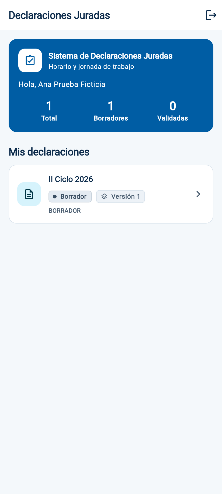
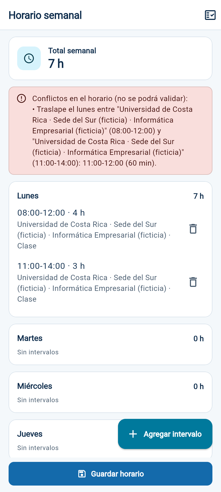
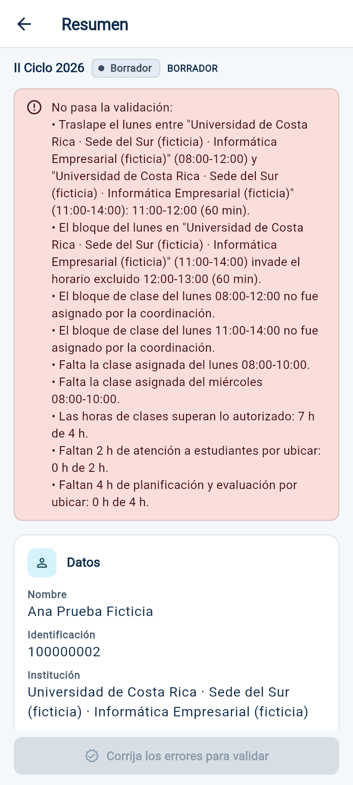

# Declaraciones Juradas – app móvil (Laboratorio IF0009)

Repositorio: https://github.com/luciaapalacio608-dot/declaracion_jurada_movil

App Flutter (web adaptable a celular) para que el personal docente declare su
horario y jornada. Reutiliza el proyecto **DeclaraHorario** sin modificarlo:
se importa como dependencia por ruta (`declara_horario: path: ../DeclaraHorario`).

## Cómo correr el proyecto (guía para la revisión)

La app **no tiene un backend propio**: importa el proyecto del equipo,
**DeclaraHorario**, como dependencia local (`declara_horario: path:
../DeclaraHorario` en `pubspec.yaml`). Por eso se necesitan **los dos
repositorios, uno al lado del otro**, y los datos de prueba corren en los
**emuladores locales de Firebase** (no se toca el Firebase real).

### 1. Requisitos (una sola vez)

| Herramienta | Versión probada | Para qué |
|---|---|---|
| Flutter (canal stable) | 3.47.0 (Dart 3.13) | Compilar y correr la app |
| Google Chrome | cualquiera reciente | Ver la app (web adaptable a celular) |
| Node.js | 18 o superior (probado con 24) | Cargar los datos ficticios |
| Firebase CLI | 15.x (`npm install -g firebase-tools`) | Emuladores locales |
| Java (JDK) | 11 o superior (probado con 21) | Lo exige el emulador de Firestore |

### 2. Descargar los dos repositorios en la misma carpeta

El repositorio de DeclaraHorario es **privado**: hay que pedir acceso al
equipo (Keity, Lucia o Cristopher) para poder clonarlo.

```
mkdir laboratorio
cd laboratorio
git clone https://github.com/dayanachavarriasteller-maker/DeclaraHorario.git
git -C DeclaraHorario checkout develop
git clone https://github.com/luciaapalacio608-dot/declaracion_jurada_movil.git
```

Debe quedar así (el nombre `DeclaraHorario` tiene que ser exacto):

```
laboratorio/
├── DeclaraHorario/              ← proyecto del equipo (rama develop)
└── declaracion_jurada_movil/    ← este laboratorio
```

La app se probó con DeclaraHorario en la rama `develop`, commit `fb156d0`.

### 3. Instalar dependencias

```
cd declaracion_jurada_movil
flutter pub get
```

### 4. Encender los emuladores con datos ficticios

En Windows (PowerShell), desde `declaracion_jurada_movil`:

```
.\tool\emuladores.ps1
```

El script copia las reglas de seguridad de DeclaraHorario a `firebase/`,
abre los emuladores en otra ventana (**no la cierre**) y carga los datos
ficticios. Si PowerShell bloquea el script, ejecute antes
`Set-ExecutionPolicy -Scope Process Bypass`. Si el Firebase CLI pide
iniciar sesión, ejecute `firebase login` y vuelva a intentarlo.

En macOS/Linux (o si prefiere hacerlo a mano), con dos terminales:

```
# Terminal 1 (se queda abierta)
cp ../DeclaraHorario/firestore.rules ../DeclaraHorario/storage.rules firebase/
firebase emulators:start --only auth,firestore,storage --project declarahorario-b186f

# Terminal 2, cuando los emuladores estén listos
FIRESTORE_EMULATOR_HOST=127.0.0.1:8080 FIREBASE_AUTH_EMULATOR_HOST=127.0.0.1:9099 node tool/seed_emuladores.js
```

Se crean (solo en los emuladores):

| Cuenta | Contraseña | Rol |
|---|---|---|
| `declarante@ucr.ac.cr` | `123456` | Declarante (Ana Prueba Ficticia) |
| `revisor@ucr.ac.cr` | `123456` | Superior (no se usa en el laboratorio) |

Además: sede, carrera y el período "II Ciclo 2026" (habilitado), y la
asignación de la coordinación: curso ficticio con clases **lunes y miércoles
de 8:00 a 10:00**, jornada **1/4 TC (10 h)**.

### 5. Correr la app

```
flutter run -d chrome --dart-define=USE_EMULATORS=true --web-browser-flag=--window-size=412,915
```

o, en Visual Studio Code, **Ejecutar y depurar → "Chrome · emuladores (datos
ficticios)"**.

> Importante: sin `--dart-define=USE_EMULATORS=true` la app se conecta al
> Firebase real, donde las cuentas de prueba no existen y el inicio de sesión
> dice "Correo o contraseña incorrectos".

Entre con `declarante@ucr.ac.cr` / `123456`. Con los emuladores, la sesión no
se guarda entre recargas: después de recargar la página hay que volver a
iniciar sesión (ver "Dificultades").

### 6. Recorrido sugerido para revisar (≈ 3 minutos)

1. **Pantalla principal:** toque **Nueva declaración** (o abra la existente).
2. **Formulario:** elija un puesto y la jornada **1/4 TC** → **Guardar
   borrador**. Borre el puesto y guarde: aparece el aviso de campo incompleto.
3. **Horario semanal** (botón al final del formulario) → **Agregar
   intervalo**: lunes 08:00–12:00 y lunes 11:00–14:00 → aparece el
   **conflicto** (caso obligatorio). Toque el ícono de resumen: no deja validar.
4. Corrija con este horario válido para la asignación ficticia y **Guarde**:
   lunes 08:00–10:00 *Clase*, miércoles 08:00–10:00 *Clase*, martes
   08:00–10:00 *Atención* y jueves 08:00–12:00 *Planificación* (total 10 h).
5. **Resumen:** dice "Pasa todas las validaciones" → **Validar declaración**
   → estado **VALIDADA**.
6. Recargue la página, vuelva a entrar y abra la declaración: los datos y el
   horario siguen guardados.

### 7. Pruebas automáticas

```
flutter test
```

16 pruebas con datos ficticios (no necesitan los emuladores).

### 8. Opcional: probar en un celular Android por cable

1. Active la depuración USB en el teléfono y conéctelo.
2. Compile y sirva la versión web, y redirija los puertos al teléfono:

```
flutter build web --release --dart-define=USE_EMULATORS=true
node tool/servir.js        # se queda abierto; lo siguiente en otra terminal
adb reverse tcp:8001 tcp:8001
adb reverse tcp:9099 tcp:9099
adb reverse tcp:8080 tcp:8080
adb reverse tcp:9199 tcp:9199
```

3. En el navegador del teléfono abra `http://127.0.0.1:8001`.

Las redirecciones de `adb reverse` se pierden si se desconecta el cable.

## Estructura

```
lib/
  main.dart                  Inicializa Firebase (y los emuladores con USE_EMULATORS=true)
  app/
    lab_app.dart             Providers, tema y MaterialApp.router
    lab_router.dart          Rutas: login de DeclaraHorario + pantallas del laboratorio
    lab_routes.dart          Rutas propias: /schedule y /summary
  logic/                     Lógica pura (sin Flutter), probada con tests
    declaration_form.dart    R2: campos obligatorios y consistencia del formulario
    weekly_schedule.dart     R3/R4: duración, total, fin > inicio y traslapes
  screens/
    home_screen.dart         R1: lista de declaraciones y estados, crear nueva
    formulario_screen.dart   R2: datos de la declaración
    horarios_screen.dart     R3/R4: horario de lunes a sábado
    resumen_screen.dart      R6: resumen, validación y "Corregir"
    declaration_watch.dart   Escucha la declaración y su versión en Firestore
  core/
    emulator_session.dart    Con emuladores en web: borra la sesión guardada
docs/capturas/               Capturas de la app (tamaño celular)
test/                        Tests con datos ficticios
tool/                        Emuladores, datos de prueba y prueba en el celular
```

## Qué se reutilizó de DeclaraHorario

| Pieza | Uso en el laboratorio |
|---|---|
| `AuthState`, `authRoutes()`, `RouteGuard` | Login, registro y perfil (no se reconstruyó el login) |
| `DeclarationState` | Listar, crear y abrir declaraciones (R1) |
| `ScheduleState` y repositorios Firestore | Guardar nombramiento, otras instituciones, bloques y observaciones (R2, R3, R5) |
| `OverlapDetector`, `TimeRules` | Detección de traslapes y cálculo de duraciones (R3, R4) |
| `ValidationState` / `ScheduleValidator` | Validación completa y paso a `VALIDADA` (R4, R6) |
| `WorkloadCatalog`, `AppointmentDefaults`, `CourseRules` | Jornadas, institución, vigencia y curso asignado |
| `AppTheme`, `StatusChip`, `InfoCard`, `InlineBanner`… | Tema UCR y componentes visuales |
| `DeclarationStatus` | Estados originales: `BORRADOR`, `VALIDADA`, `PENDIENTE_FIRMA_DECLARANTE`… |

## Cómo se guardan los borradores (R5)

- Cada declaración vive en `declarations/{id}` con su versión actual en
  `declarations/{id}/versions/{versionId}`; el nombramiento y las otras
  instituciones son subcolecciones de la versión, y los intervalos del horario
  son sus `blocks`.
- El laboratorio escribe **solo** a través de `ScheduleState` (los mismos
  repositorios, reglas de Firestore y eventos de auditoría de DeclaraHorario).
- Convención de fechas: `fromMap` convierte `Timestamp → DateTime`; `toMap`
  no incluye fechas del servidor, que se agregan con
  `FieldValue.serverTimestamp()` (lo hacen los repositorios reutilizados).
- Al volver a abrir una declaración, las pantallas escuchan Firestore y
  rellenan el formulario y el horario con lo guardado.
- Si se edita una declaración `VALIDADA`, vuelve a `BORRADOR` y debe validarse
  de nuevo.

## Validaciones

- **R2:** nombre, identificación, institución, puesto, jornada y vigencia son
  obligatorios; cada institución adicional requiere nombre, tipo, puesto y
  jornada; en total no pueden superar 20 h por semana.
- **R4:** la hora de fin debe ser posterior a la de inicio, y no puede haber
  traslapes el mismo día, aunque sean de instituciones distintas.
  Caso obligatorio: lunes 08:00–12:00 y 11:00–14:00 → conflicto
  (11:00–12:00). Mientras exista, el botón **Validar declaración** está
  deshabilitado y la declaración no puede quedar `VALIDADA`.
- **R6:** el resumen ejecuta además el `ScheduleValidator` de DeclaraHorario
  (jornada declarada vs. esperada, horas de clase, etc.).

## Pruebas

```
flutter test
```

| # | Prueba pedida | Dónde |
|---|---|---|
| 01 | Guardar una declaración válida y ver el resumen | `declaration_form_test.dart` + recorrido real con emuladores: capturas 03, 08, 09 y 11 |
| 02 | Detectar horarios que chocan (lunes 8–12 / 11–14) | `weekly_schedule_test.dart` + capturas 06 y 07 |
| 03 | Avisar de campos incompletos | `declaration_form_test.dart` + captura 12 |
| 04 | Cerrar y volver a abrir un borrador sin perder datos | Recorrido real: se cerró la sesión, se volvió a entrar y el horario seguía guardado (captura 10) |
| 05 | Se ve bien en el celular (360 px) | `login_mobile_test.dart` (360×640 y 412×915, fuente Roboto real) + todas las capturas (412×915) |

Las pruebas 01 y 04 se verificaron en la app real contra los emuladores
(ver capturas). Pendiente opcional: automatizarlas con `fake_cloud_firestore`.

### Prueba manual sugerida (01, 02 y 04)

1. Entrar, crear la declaración del "II Ciclo 2026" y llenar el formulario.
2. Horario: lunes 08:00–12:00 y lunes 11:00–14:00 → aparece el conflicto y el
   resumen no permite validar.
3. Corregir (p. ej. lunes 12:00–14:00), guardar, salir y volver a entrar: los
   datos siguen ahí.
4. Resumen → **Validar declaración** → estado `VALIDADA`.

## Capturas

Tomadas en tamaño de celular (412×915) con los emuladores y datos ficticios,
en la carpeta `docs/capturas/`:

| # | Pantalla | Archivo |
|---|---|---|
| 1 | Pantalla principal (R1) | `01-principal.png` |
| 2 | Formulario de la declaración (R2) | `02-formulario.png` |
| 3 | Borrador guardado en Firebase (R5) | `03-guardado.png` |
| 4 | Horario semanal vacío (R3) | `04-horario-vacio.png` |
| 5 | Agregar intervalo: día, inicio, fin, institución | `05-nuevo-intervalo.png` |
| 6 | Caso obligatorio: lunes 8–12 y 11–14 → conflicto (R4) | `06-horario-conflicto.png` |
| 7 | Resumen que no permite validar por el conflicto (R4/R6) | `07-resumen-conflicto.png` |
| 8 | Horario corregido: 10 h, sin choques | `08-horario-valido.png` |
| 9 | Resumen que pasa todas las validaciones (R6) | `09-resumen-valido.png` |
| 10 | Borrador recuperado tras cerrar sesión y volver a entrar (R5) | `10-borrador-recuperado.png` |
| 11 | Declaración en estado VALIDADA | `11-validada.png` |
| 12 | Aviso de campo obligatorio incompleto (R2) | `12-campos-incompletos.png` |





- TODO: enlace al video (máximo 2 minutos).

## Justificación visual (Manual de identidad UCR)

Fuente consultada: *Manual de identidad visual de la Universidad de Costa
Rica*, Oficina de Divulgación e Información (ODI), versión web 2019
(https://psico.ucr.ac.cr/images/recursos/2019_manual-identidad-visual-web.pdf).

- **Colores (manual, p. 28 y p. 31):** la página 28 define los colores
  principales: celeste UCR `#00C0F3` (Pantone 298 C), azul UCR `#005DA4`
  (Pantone 2945 C) y blanco, más el amarillo UCR y el verde UCR "en menor
  proporción". La app usa exactamente esos valores, definidos **una sola vez**
  en el tema (`AppColors`/`AppTheme` de DeclaraHorario); ningún widget del
  laboratorio declara colores propios, todos salen de `Theme.of(context)`.
  Siguiendo la jerarquía de color de la página 31, predominan el azul, el
  celeste y el blanco (encabezado azul, botones principales azules, avisos
  informativos celestes, fondo claro) y el amarillo y el verde quedan como
  acento. La misma página pide "un contraste adecuado de color" para la
  accesibilidad: el texto va en azul oscuro sobre fondo claro o en blanco
  sobre azul, nunca celeste o amarillo sobre blanco.
- **Tipografía (manual, p. 24 y p. 25):** el sistema contempla Myriad Pro y
  Trueno para textos sans-serif, y ambas páginas indican que "puede
  sustituirse, si no está disponible, por la tipografía Arial". La app usa
  Roboto, la tipografía del proyecto DeclaraHorario, que es una sans-serif
  neo-grotesca muy cercana a Arial en proporciones y legibilidad. Se eligió
  porque Flutter web la incluye siempre (Arial no existe en Android) y porque
  la app debe verse igual que el sistema que reutiliza; además se verificó con
  ella que no haya desbordes a 360 px.
  Nota: la p. 25 indica que Trueno es de licencia abierta, por lo que una
  mejora futura es incluir Trueno como fuente de la app.
- **Logos (manual, p. 49 y p. 122):** la p. 122 pide que las aplicaciones
  electrónicas respeten la identidad visual (firmas, paleta, tipografías) y la
  p. 49 regula cómo usar las firmas oficiales según el fondo. Para no
  modificar ni recrear la firma institucional, la app no incluye logos; solo
  usa la paleta y la tipografía. Si se agregara, debería ser el archivo
  oficial de la ODI sin alteraciones.
- **Accesibilidad:** botones de al menos 48–52 px de alto, campos con
  etiqueta y mensaje de error debajo de cada uno, selectores grandes de día y
  hora, y soporte desde 360 px de ancho sin desbordes.

## Dificultades

- No modificar DeclaraHorario: se importó por ruta y se reemplazó solo el
  enrutador (la pantalla principal del laboratorio sustituye al selector de
  roles).
- Las reglas de Firestore exigen datos coherentes (vigencia del período,
  minutos semanales según la jornada), por eso esos campos se muestran en
  solo lectura.
- Probar en el celular por cable: el servidor debe escuchar en `127.0.0.1` y
  las redirecciones `adb reverse` se pierden al reconectar.
- Con una sesión guardada, Firebase Auth (web) consultaba el proyecto real
  antes de conectarse al emulador y luego ya no aceptaba el emulador, por lo
  que la cuenta de prueba daba "Correo o contraseña incorrectos". Se resolvió
  en `lib/core/emulator_session.dart`: solo con `USE_EMULATORS=true` se borra
  la sesión guardada antes de iniciar Firebase.
- Los selectores de hora salían en inglés: se agregó `flutter_localizations`
  (español de Costa Rica). Como DeclaraHorario fija `intl ^0.19.0`, el
  laboratorio usa `dependency_overrides` para `intl ^0.20.3`, sin modificar
  DeclaraHorario.

## Reflexión

**1. ¿Qué se reutilizó del proyecto DeclaraHorario y qué ventajas trajo?**

Casi todo el "backend" de la app es reutilizado: el inicio de sesión y el
registro (`AuthState`, `authRoutes()`, `RouteGuard`), los modelos
(`Declaration`, `Appointment`, `ExternalJob`, `TimeBlock`), los estados que
leen y escriben en Firestore (`DeclarationState`, `ScheduleState`), las reglas
de negocio (`OverlapDetector`, `TimeRules`, `ScheduleValidator`,
`WorkloadCatalog`) y el tema con los componentes visuales. El laboratorio solo
agrega pantallas pensadas para el celular y dos clases de lógica pura
(`DeclarationFormValidator` y `WeeklySchedule`). La ventaja principal es que
la app móvil obedece exactamente las mismas reglas de Firestore y de negocio
que el sistema web: un borrador creado en el celular se puede abrir en
DeclaraHorario y viceversa, y no hubo que volver a programar ni probar la
detección de traslapes, el login ni la persistencia.

**2. ¿Qué dificultades presentó adaptar la interfaz a una pantalla pequeña?**

En 360 px de ancho no caben tablas ni formularios en varias columnas, así que
todo se organizó en una sola columna de tarjetas desplazable, con el botón
principal ("Guardar borrador", "Guardar horario", "Validar declaración") fijo
abajo para que siempre esté al alcance del pulgar. El horario semanal, que en
la web es una cuadrícula, se convirtió en una tarjeta por día con sus
intervalos, y la creación de un intervalo pasó a una hoja inferior con
selectores grandes de día y hora. Los textos largos (por ejemplo el nombre de
la institución) obligaron a usar `isExpanded`, `Wrap` y elipsis para evitar
desbordes, y se comprobó con pruebas a 360×640 y 412×915 usando la fuente
real. También costó probar en el teléfono físico: hubo que servir la app por
cable con `adb reverse` y resolver problemas de red y de sesión.

**3. ¿Cómo contribuyó el Manual de identidad visual de la UCR al diseño?**

El manual dio una paleta cerrada (celeste, azul, blanco, amarillo y verde) que
evita elegir colores al azar: el azul institucional se usa para los botones
principales y el encabezado, el celeste para los avisos informativos y los
íconos, y los colores de error se mantienen para los conflictos, de modo que
el significado de cada color es constante. Al definir los colores una sola vez
en el `ThemeData`, todas las pantallas quedan coherentes y es fácil
corregirlos. El manual también recuerda no modificar ni inventar logos, por
lo que se decidió no incluir ninguno. En cuanto a la tipografía, se usó una
sans-serif legible como sustituto de Trueno/Myriad Pro, y se cuidó el
contraste entre texto y fondo para que la app sea accesible.

**4. ¿Qué cambios habría que hacer para integrar la firma y la aprobación?**

La base ya existe en DeclaraHorario: los estados de firma y revisión
(`PENDIENTE_FIRMA_DECLARANTE` y los siguientes), el `WorkflowService` con sus
transiciones y las pantallas de firma, revisión y Recursos Humanos. Para
integrarlas en la app móvil habría que: (1) agregar al enrutador del
laboratorio las rutas de firma y seguimiento que ya define DeclaraHorario;
(2) añadir en el resumen un botón "Continuar a la firma" cuando la declaración
esté `VALIDADA`; (3) adaptar a pantalla pequeña la firma (por ejemplo, subir el
PDF firmado desde el teléfono, lo que requiere permisos de archivos); (4) dar
una vista móvil a la bandeja del superior y de Recursos Humanos, que hoy está
pensada para escritorio; y (5) agregar notificaciones para avisar cuando una
declaración cambia de estado. Las reglas de Firestore y los eventos de
auditoría ya contemplan estas transiciones, así que el trabajo sería sobre
todo de interfaz.
